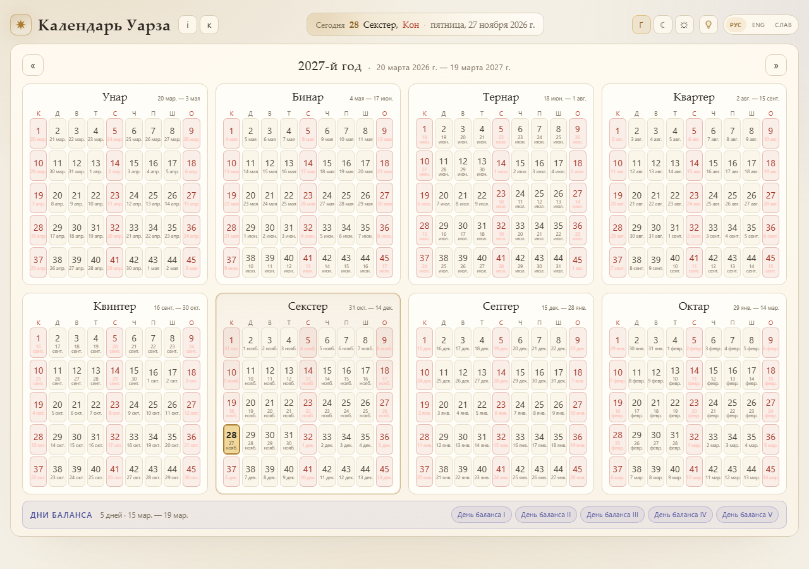

# Календарь Уарза

Уарзианский календарь (UC) — 8 месяцев по 45 дней, вечная 9-дневная неделя
с ритмом 3-1-3-2, выходные 1/5/9 (красным) и Дни Баланса вне недель.
Считается из конфига, рядом с каждой датой — григорианская.



**Демо:** https://voidterror.github.io/balance-calendar/

## Устройство

| | |
| --- | --- |
| Год | 8 месяцев × 45 дней = 360 + 5 дней баланса (6 в високосный год) |
| Месяцы | три ряда: Унар…Октар (рус.), Unar…Octar (eng), Пролетник…Лютень (слав.) |
| Неделя | 9 дней: Кон, Дельник, Вторник, Третник, Середа, Четверг, Пятница, Шестница, Осьмица |
| Месяц | ровно 5 недель; 1-е число всегда Кон, месяц заканчивается на Осьмицу |
| Выходные | 1-й, 5-й и 9-й дни: Кон, Середа, Осьмица |
| Дни баланса | 5 дней в конце года (6 в високосный), вне недели — без дня недели |
| Високосы | каждый 4-й, кроме кратных 128 (правило применяется всегда) |
| Эпоха | 1 Пролетник 2001 года = 20 марта 2000 (григорианский) |
| Нумерация | год 2027 = 20.03.2026 — 19.03.2027 |

На 26 ноября 2026 календарь показывает **27 Секстер 2027 года, Осьмица**
(в славянском ряду — 27 Грудень 2027) — 252-й день года и 3-я неделя месяца.

## Что умеет

- **год — единственный основной вид**: все 8 месяцев в крупной сетке 4×2, текущий месяц подсвечен, дни баланса — строкой снизу;
- **месяц открывается попапом** по клику на месяц: сетка с подсветкой сегодняшнего дня, выбранной даты и красных выходных, стрелки для листания и крестик для закрытия;
- **дни баланса** открываются своим попапом; клик по дню выбирает его;
- григорианская дата под каждым днём месяца и в карточке дня;
- плашка «сегодня» в шапке: дата, день недели и григорианская дата;
- **кнопка «Г»** — григорианские даты под числами в году (числа уменьшаются); включена по умолчанию, состояние запоминается; **диапазоны месяцев** в карточках видны только в этом режиме;
- **кнопки «i» и «к»** рядом с названием: краткое описание календаря и конвертер «григорианская дата → своя» в диалогах;
- **переключатель РУС / ENG / СЛАВ** — три ряда названий месяцев; язык и настройки запоминаются в браузере;
- **кнопка ☾** — слой фаз Луны (SVG-значки): включается вместо «Г» и рисует фазу под числом; новолуния и полнолуния обведены белым. Фазы считаются по синодическому месяцу 29,530588853 дня от новолуния 6 января 2000; это астрономическое приближение, для точного совпадения с 19 листами нужна таблица фаз;
- **кнопка ☼** — солнечный слой (SVG-значки): заполнение кружка показывает нормированную долю дня — пусто в самый короткий день, полно в самый длинный, половина в равноденствие; равноденствия и солнцестояния обведены белым; считается по фазе года от мартовского равноденствия;
- листание стрелками `↑` `↓` (годы), `T` или `Home` — сегодня;
- ноль зависимостей и сборки: только HTML, CSS и ES-модули.

## Лунный и солнечный слои

- **☾ Луна** — SVG-фазы по синодическому месяцу 29,530588853 дня от новолуния
  6 января 2000. В шапке года виден лист цикла: **2027 = лист 13/19** (якорь из
  книги), 2028 = 14/19 и так далее с периодом 19.
- Через 19 лет фазы почти повторяются: 235 лунных месяцев = 6939,688 дня,
  19 тропических лет = 6939,602 дня — разница около 2 часов за цикл. Поэтому
  у границ фаз возможен сдвиг на день; таблица 19 листов из книги даёт точное
  повторение.
- **☼ Солнце** — нормированная доля дня: пусто в самый короткий день, полно в
  самый длинный, половина в равноденствие. Считается по фазе года от мартовского
  равноденствия и не зависит от широты.

## Свой календарь

Всё описание живёт в [`config.js`](config.js):

| Поле | Что задаёт |
| --- | --- |
| `weekdays` | названия дней недели; их количество — длина недели |
| `weekends` | номера выходных дней, с 1 (например `[1, 5, 9]`) |
| `months[].name` / `days` | название и длина месяца; длина может быть любой |
| `extra.days` | дни, не входящие ни в один месяц; могут быть в конце года |
| `leap.every` | каждый N-й год длиннее на `leap.days.length` дней |
| `leap.offset` | сдвиг фазы: високосные годы `y + offset ≡ 0 (mod every)` |
| `leap.exceptEvery` | исключение: годы, кратные N, не високосные (правило 128) |
| `epoch.year` / `epoch.gregorian` | какой григорианской дате соответствует 1-й день 1-го месяца |

Три ряда названий лежат в `config.js` в блоке `NAMES` и подставляются через
`localizedConfig(mode, use128)`: `ru` — метрические русские, `en` — международные,
`slav` — славянские. Дни недели — славянские (в `en` — транслитерация).

Сетки, навигация и подсветка подстроятся сами. Если `extra.days`
пуст и високосных дней нет, дополнительный период просто не появится.

## Как это считается

Внутри всё сводится к **номеру дня** — целому числу дней от 1970-01-01
(отрицательные значения работают для дат до эпохи):

1. Григорианская дата → номер дня через `Date.UTC`.
2. Номер дня → свой год: начало года = `эпоха + base × Δлет + leapDays × (число високосных лет)`,
   где `base = сумма дней месяцев + дни вне месяцев`.
3. Остаток внутри года делится на месяцы по их длинам; хвост — дни баланса.
4. Внутри месяца неделя начинается заново: день недели = `(число месяца − 1) mod 9`,
   поэтому 1-е число каждого месяца — Кон, а 45-дневный месяц — ровно 5 недель.
5. Дни баланса стоят вне недели: у них нет дня недели, а следующий год снова
   начинается с Кона.

Проверки — в [`tests/engine.test.mjs`](tests/engine.test.mjs): перевод туда-обратно
на диапазоне ±40 000 дней, даты до эпохи, високосы, выходные, сброс
недели в каждом месяце, дни баланса вне недели, а также миры с другой длиной
недели и без дней вне месяцев.

```bash
npm test
```

## Запуск

ES-модули не грузятся через `file://`, поэтому нужен любой локальный сервер:

```bash
python -m http.server 8765
# или
npx serve .
```

Открыть http://localhost:8765

## Публикация на GitHub Pages

Страница отдаётся из ветки `main`, корень. Если форкаете — включите в
**Settings → Pages → Deploy from a branch → main / (root)**.

## Структура

```
index.html   разметка
styles.css   оформление
app.js       UI: сетки, навигация, диалоги, языки
engine.js    чистая календарная математика (без DOM)
config.js    описание календаря — единственный файл, который нужно менять
tests/       тесты движка на node:test
```

## Мелочи, о которых стоит знать

- «Сегодня» — локальная дата устройства, а не UTC.
- Григорианские даты показываются по UTC, чтобы не прыгать на день назад
  в западных часовых поясах.
- Високосное правило сейчас — раз в 4 года; поменять можно в `leap`.

## Лицензия

MIT — см. [LICENSE](LICENSE).
