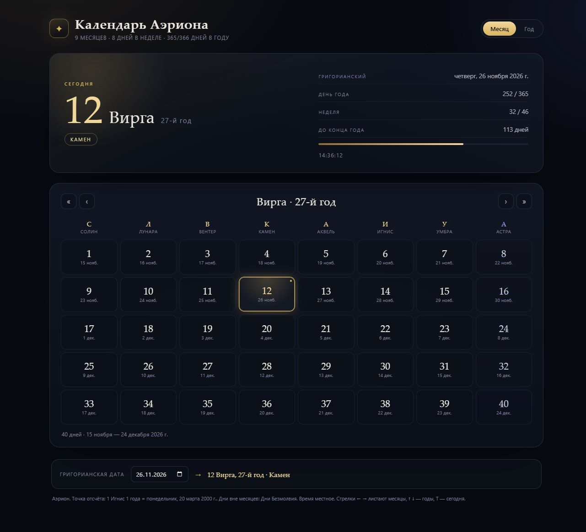

# Календарь Аэриона

Календарь вымышленного мира в одном HTML-файле: **9 месяцев по 40 дней**,
**8-дневная неделя**, пять **Дней Безмолвия** между годами и лишний **День Обета**
раз в четыре года. Рядом с каждой датой — григорианская, «сегодня» подсвечено,
всё остальное считается из конфига.



**Демо:** https://voidterror.github.io/aerion-calendar/

## Что умеет

- сетка месяца с подсветкой сегодняшнего дня и выбранной даты;
- григорианская дата под каждым днём месяца и в карточке дня;
- вид «Год» — все месяцы сразу, с мини-сетками и днями вне месяцев;
- конвертер «григорианская дата → своя»;
- день года, номер недели, сколько дней осталось до конца года;
- листание стрелками `←` `→` (месяцы), `↑` `↓` (годы), `T` или `Home` — сегодня;
- ноль зависимостей, ноль сборки: только HTML, CSS и ES-модули.

## Свой мир за пару минут

Всё описание мира живёт в [`config.js`](config.js). Например, мир из 13 месяцев
по 28 дней с семидневной неделей и одним днём вне времени:

```js
export const CONFIG = {
  world: "Тринадцать Лун",
  weekdays: ["Пн", "Вт", "Ср", "Чт", "Пт", "Сб", "Вс"],
  months: Array.from({ length: 13 }, (_, i) => ({ name: `Луна ${i + 1}`, days: 28 })),
  extra: { label: "День Вне Времени", days: [{ name: "День Вне Времени" }] },
  leap: { every: 4, offset: 3, days: [{ name: "День Прыжка" }] },
  epoch: { year: 1, gregorian: "2000-01-01" },
};
```

| Поле | Что задаёт |
| --- | --- |
| `weekdays` | названия дней недели; их количество — длина недели |
| `months[].name` / `days` | название и длина месяца; длина месяца может быть любой |
| `extra.days` | дни, не входящие ни в один месяц; могут быть в конце года |
| `leap.every` | каждый N-й год длиннее на `leap.days.length` дней |
| `leap.offset` | сдвиг фазы правила: високосные годы `y + offset ≡ 0 (mod every)` |
| `epoch.year` / `epoch.gregorian` | какой григорианской дате соответствует 1-й день 1-го месяца |

Меняются названия, число месяцев, длина месяцев и недели — сетки, навигация и
конвертер подстроятся сами. Если `extra.days` пуст и високосных дней нет,
дополнительный период просто не появится.

## Как это считается

Внутри всё сводится к **номеру дня** — целому числу дней от 1970-01-01
(отрицательные значения работают для дат до эпохи):

1. Григорианская дата → номер дня через `Date.UTC`.
2. Номер дня → свой год: начало года вычисляется как
   `эпоха + base × Δлет + leapDays × (число високосных лет)`, где
   `base = сумма дней месяцев + дни вне месяцев`.
3. Остаток внутри года делится на месяцы по их длинам; хвост — дни вне месяцев.
4. День недели непрерывен: `(номер дня − номер дня эпохи) mod длина недели`,
   поэтому недели не обнуляются на границе года.

Проверки лежат в [`tests/engine.test.mjs`](tests/engine.test.mjs):
перевод туда-обратно на диапазоне ±40 000 дней, даты до эпохи, високосные годы,
миры с другой длиной недели и без дней вне месяцев.

```bash
npm test
```

## Запуск

ES-модули не грузятся через `file://`, поэтому нужен любой локальный сервер:

```bash
python -m http.server 8765
# или
npx serve .
```

Открыть http://localhost:8765

## Публикация на GitHub Pages

Репозиторий уже настроен: страница отдаётся из ветки `main`, корень.
Если форкаете — включите в **Settings → Pages → Deploy from a branch → main / (root)**.

## Структура

```
index.html   разметка
styles.css   оформление
app.js       UI: сетки, навигация, конвертер, часы
engine.js    чистая календарная математика (без DOM)
config.js    описание мира — единственный файл, который нужно менять
tests/       тесты движка на node:test
```

## Мелочи, о которых стоит знать

- «Сегодня» — локальная дата устройства, а не UTC.
- Дни вне месяцев продолжают общий счёт недели (как если бы это были обычные дни).
- В григорианском календаре даты показываются по UTC, чтобы не прыгать на день
  назад в западных часовых поясах.
- Названия мира — вымышленные; лицензия позволяет заменить их на свои.

## Лицензия

MIT — см. [LICENSE](LICENSE).
